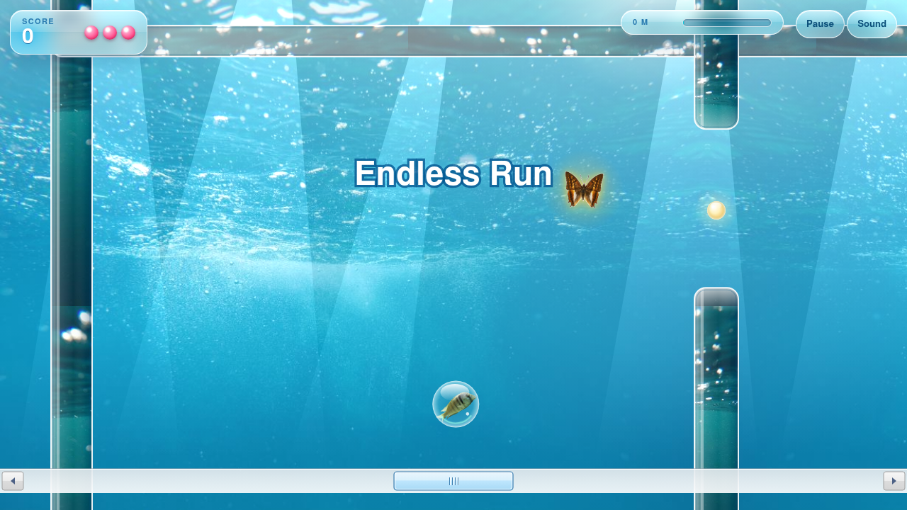

# Aqua Drift

A Frutiger Aero endless brick-breaker side-scroller. A photoreal fish rides
inside a glass bubble. Keep it bouncing on a Windows 7-style scrollbar thumb,
smash glass bricks, slip through moving pillar gaps, and travel as far as you can.



**Play in the browser:** https://downgear.github.io/aqua-drift/

**Download:** see [Releases](https://github.com/downgear/aqua-drift/releases).
Unzip it and open `index.html`; no install or server is needed.

## Controls

| Action | Input |
| --- | --- |
| Launch the fish | Click, tap, or Enter |
| Move the platform | Mouse / drag |
| Shift the view after launch | Left / Right arrow keys, A / D, or the scrollbar arrow buttons |
| Pause / resume | Space, P, Esc, or the Pause button |
| Toggle sound | M or the Sound button |

At the start of each run, the platform stays fixed in the centre. The launch click
cannot reposition it, and mouse input remains locked until the fish has visibly
cleared the platform.

After that initial separation, the platform tracks the mouse or drag position
directly. Fish movement never pulls the platform away from the pointer. The camera
shifts the stage around the fish inside a limited viewing zone, so the fish never
bounces against the browser's left or right side. The scrollbar and platform stay
fixed in screen space while the course moves behind them. The top of the browser
remains active: the fish can still hit it and bounce downward normally.

There is no life counter or game-over limit. If the fish falls past the platform,
the endless run immediately restarts from the beginning. Bricks and pickups return,
and both distance and score reset to zero. Your best score is saved automatically.

## Endless course

The course is generated deterministically ahead of the fish and has no goal
portal or next stage. Gaps gradually narrow, moving pillars become more common,
and tough glass bricks appear more often as distance increases.

## Scoring

- Glass brick: 50 points (100 for tough double-rim bricks)
- Golden pearl: 25 points
- Rare butterfly: 250 points
- Passing a gate: 100 points

## Develop

```sh
npm install
npm run dev      # serves the source at http://localhost:5173
npm run build    # writes a self-contained build to dist/
```

The source is plain HTML/CSS/JS with no framework. The build inlines and minifies
everything into `dist/index.html` and copies `assets/` alongside it.

## Credits

All images are royalty-free (CC0 or public domain). See [CREDITS.md](CREDITS.md).

Special thanks to **Đậu Văn Đăng Khoa** for supporting me with his toilet.
